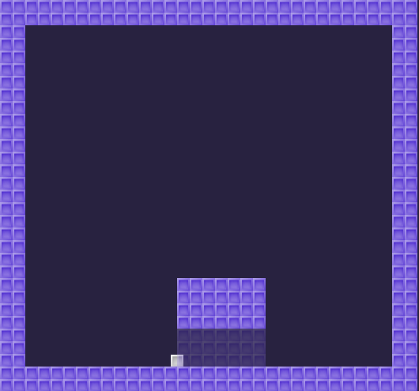
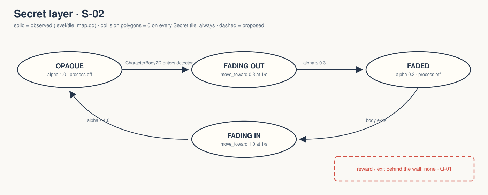

# walker-2d-dynamic-tilemap-layers: Game Design Document (recovered)

| | |
|---|---|
| Version | 0.1.0-recovered |
| Date | 2026-09-27 |
| Author | Zelda (agent, silent), for Nik Bear Brown |
| Mode | recovered · `/gdd reverse --path godot silent` |
| Revision | 1 |
| Gates | vision ○ · systems ○ · world ○ · scope ○. Gate unsigned at time of writing |
| Classification | **Tech demo, not a game.** One screen, one fake wall, one walking square. No goal, fail state or end. |

Provenance tags: `[OBSERVED path:line]` · `[INFERRED]` with evidence · `[MISSING]`. Paths are relative to `godot/` unless they start with the folder root. A recovered GDD describes what exists. It approves none of it.

*`godot/screenshots/fake_wall.png` (530×495), shipped upstream and referenced by `godot/README.md:20`. This is design art, not a Walker capture. `FRICTIONAL.md:16-17` says the rendered fade is unverified.*

## 1. Vision summary

**What it is.** An "example of how to make a fake wall using TileMap's `_tile_data_runtime_update()` method. It shows how to disable collisions per layer" `[OBSERVED godot/README.md:3-5]`. The upstream note says Godot 4.3+ TileMapLayer can do this with an inspector checkbox. This demo shows the per-tile runtime route `[OBSERVED godot/README.md:7-10]`.

**Player fantasy / target player.** `[MISSING]` `[INFERRED]` The audience is Godot learners working on tilemaps. The only "discovery" beat is walking into a wall that fades.

**Oddity.** The `config/description` in `project.godot:14-16` describes a kinematic-character demo with moving and one-way platforms, none of which exist here. `[INFERRED]` This is a description carried over from another upstream demo. It is recorded, not corrected, because the task forbids edits under `godot/`.

**Biggest unresolved question.** Is the fake wall meant to teach the API, or to be the seed of a secret-finding platformer? Q-01.

## 2. Design pillars

`[MISSING]` None stated.

## 3. Core loop

**Micro.** Walk right, pass through the Secret layer's tiles (no collision), the layer fades to 30% alpha, walk out and it fades back to 100% `[OBSERVED tile_map.gd:12-51; world.tscn:29-49]`.
**Meso / macro.** `[MISSING]` No level exit, collectible, timer or reset exists.
**Loop honesty test.** One observation, repeatable. This is not a game loop.

## 4. Player Experience Goals

`[MISSING]` None authored. Candidate, `[INFERRED]`: PX-01, "the player feels they found a hidden passage". The evidence is the fade-on-enter design. Not approved.

## 5. Mechanics

### M-01 Walk `[OBSERVED player/player.gd:3-19]`
`WALK_FORCE 600`, `WALK_MAX_SPEED 200`, `STOP_FORCE 1300`. Below 20% input the body decelerates. Otherwise it accelerates and is clamped to ±200.

### M-02 Jump `[OBSERVED player/player.gd:6,29-31]`
`JUMP_SPEED 200`, only when `is_on_floor()` and `jump` was just pressed. Gravity comes from project settings, 500 (`project.godot:65`), via `get_gravity()` (line 22).

### M-03 Collision-free secret layer `[OBSERVED level/tile_map.gd:28-34]`
`_use_tile_data_runtime_update` returns true for every cell. `_tile_data_runtime_update` sets the collision polygon count to 0. The Secret layer shares the Ground layer's TileSet (`world.tscn:14-16,31-32`) but has no collision at runtime.

### M-04 Fade on discovery `[OBSERVED level/tile_map.gd:4-25,37-51; world.tscn:42-49]`
A `SecretDetector` Area2D (112×48 at (280,440)) reacts only to `CharacterBody2D` bodies. Inside, `layer_alpha` moves toward 0.3 at 1.0/s. Outside, it moves back toward 1.0. Processing stops once the target is reached.

Tuning values are `[OBSERVED]` numbers, not approved design.

## 6. Systems

| ID | System | Owner | Evidence |
|---|---|---|---|
| S-01 | Player controller | `Player` CharacterBody2D + `player.gd` | `[OBSERVED player/player.tscn]` |
| S-02 | Secret layer (runtime tile data + fade) | `Secret` TileMapLayer + `tile_map.gd` | `[OBSERVED world.tscn:29-33]` |

No save/load, audio or scene changes `[OBSERVED absence]`.

## 7. Progression

`[MISSING]` None.

## 8. World

`[OBSERVED]` A single room: a Ground TileMapLayer and a Secret TileMapLayer built from one 16×16 obstacle tile. A fixed Camera2D sits at offset (265,247). The viewport is 530×495 (`world.tscn:24-37; project.godot:28-29`). The clear colour is dark purple (`project.godot:72`). `[MISSING]` Setting or place.

## 9. Narrative

`[MISSING]` None.

## 10. Characters

`[OBSERVED]` One unnamed player sprite (`player/player.png`), with a 14×14 collision box (`player/player.tscn:6-17`). `[MISSING]` Name or role.

## 11. Features and priority

| ID | Feature | State | Evidence |
|---|---|---|---|
| F-01 | Walk / jump | headless-verified (D, A, W) | `secret-20260926.log` |
| F-02 | Pass through fake wall | headless-verified, x = 310.396 | same |
| F-03 | Fade to 0.3 and restore to 1.0, processing stops | headless-verified | same |
| F-04 | Solid ground still collides | headless-verified | same |
| F-05 | Rendered fade, controller input, human playtest | **unverified** | `FRICTIONAL.md:16-18` |

CORE percentage: not computed `[MISSING MVP]`.

## 12. Out of scope

`[OBSERVED absence]` Enemies, hazards, collectibles, multiple rooms, the moving and one-way platforms mentioned in the stale project description.

## 13. Technical

Godot 4.7, Compatibility renderer (`project.godot:19,70-71`). Physics at 120 ticks/s with interpolation (`:64,66`). Default gravity 500. Main scene `res://world.tscn`. Input actions: `jump` (Space, W, Up, joypad buttons 0 and 12, left stick up), `move_left` (A, Left, D-pad left, stick), `move_right` (D, Right, D-pad right, stick) (`project.godot:33-60`). The TileSet physics layer uses collision layer 1. Test: `test_secret.gd`, 11 checks.

## 14. Risks

| ID | Risk | Evidence |
|---|---|---|
| R-01 | The stale project description misleads anyone reading the project settings | `project.godot:14-16` |
| R-02 | The demo's own README says 4.3+ has a simpler route. Viewers may copy the older technique unnecessarily | `godot/README.md:7-10` |
| R-03 | Headless alpha values taken as visual proof of the fade | `FRICTIONAL.md:16-17` |

## 15. Open questions

See `design/decisions.md`: Q-01 through Q-05.

## 16. Tests

Existing: `test_secret.gd`, 11 checks (`secret-20260926.log`). Synthetic keys, real physics, no injected positions.
Proposed (dashed): T-01 a rendered capture of the fade in and out. T-02 a gamepad route. H-01 a first-time player: do they find the wall without being told?

## Zelda's notes (silent mode; what I would have said out loud)

- **Ghost Center, expected.** A fake wall with nothing behind it. As a demo, fine. As a game, the secret has to lead somewhere or it's a trick, not a discovery.
- **Flag the stale description.** It is the kind of copy-paste leftover that ends up in a film script. It's logged as R-01. Fixing it would be a `godot/` change and needs a human decision.
- **Teach the modern route first.** The upstream README itself points to the 4.3 checkbox. A film should say "here's the manual way, and here's why you might still want it", not present this as the only way.
